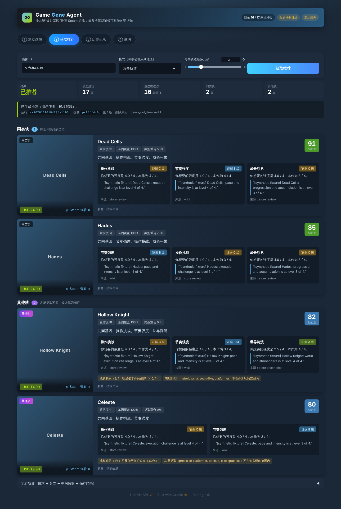

# 🧬 Game Gene Agent · 游戏基因推荐智能体

SYE 6602 course project (route: **Another Tool**). A local web app that recommends Steam games by
nine **design genes** instead of genre tags, in two tracks (same-track / cross-track), and never
recommends without a verifiable evidence sentence.

SYE 6602 课程项目（**其他工具**路线）。按九维“设计基因”而不是类型标签推荐 Steam 游戏，输出同类轨与
其他轨两条推荐；每条推荐都必须附带可核验的证据句，证据不足时明确拒绝推荐。



## Quick start · 快速开始

```bash
uv sync                      # install (Python 3.11+; https://docs.astral.sh/uv/)
cp .env.example .env         # fill in keys later; the defaults run fully offline
uv run gamegene serve        # UI: http://127.0.0.1:7860   API: http://127.0.0.1:7860/api/health
uv run pytest                # framework tests pass; unimplemented tasks show as "skipped"
```

开箱即用的是**演示服务 + 合成样例目录**（页面顶部有黄色提示）：界面、接口、存储都是真的，
但基因数据与证据句是占位数据。真实功能由两位开发按 `docs/handoff/` 完成后，把 `.env` 改为
`GAMEGENE_SERVICE=real`、`GAMEGENE_CATALOG=store` 即切换。

## Who does what · 分工

| 角色 | 负责 | 入口文档 |
|---|---|---|
| 设计 / 框架 / 前端 | `contracts/` `storage/` `llm/` `recommend/scoring.py` `profile/interview.py` `app/`（UI、API、演示服务）、全部文档 | `docs/01-architecture.md` |
| 开发 A · 数据侧 | 工作流二：`steam/` `catalog/`（采集、基因标注、证据核验、目录批处理）、300 款种子池 | `docs/handoff/DEV_A.md` |
| 开发 B · 推荐侧 | 工作流一 + 三：`profile/`（库导入、画像构建）、`recommend/`（过滤、解释、流水线）、`app/real_service.py` | `docs/handoff/DEV_B.md` |

## Documents · 文档地图

| 文档 | 内容 |
|---|---|
| `docs/01-architecture.md` | 总体架构、模块与归属、三个工作流、与课程六项要求的对应 |
| `docs/02-gene-schema.md` | 九维基因定义、0–4 等级、证据等级 A/B/C（已冻结） |
| `docs/03-data-contracts.md` | 全部数据结构、JSON 存储布局、错误码、HTTP 接口 |
| `docs/04-recommendation-spec.md` | 画像计算、硬过滤、相似度、双轨、证据门槛、解释、全部分支 |
| `docs/05-catalog-pipeline-spec.md` | Steam 接口、标注提示词、证据核验、批处理状态机 |
| `docs/06-testing-and-evidence.md` | 课程五项测试、证据留存方法、演示脚本 |
| `docs/adr/` | 架构决策记录（为什么这么定） |
| `AGENTS.md` / `CONTRIBUTING.md` | 给 AI 编码助手和人的协作规则 |

## Status · 状态

`uv run pytest -q` 的 skipped 数量就是剩余工作量：每实现一个桩函数，对应的验收测试自动从
skipped 变为 passed/failed。全部通过且无 skipped = 功能完成。
