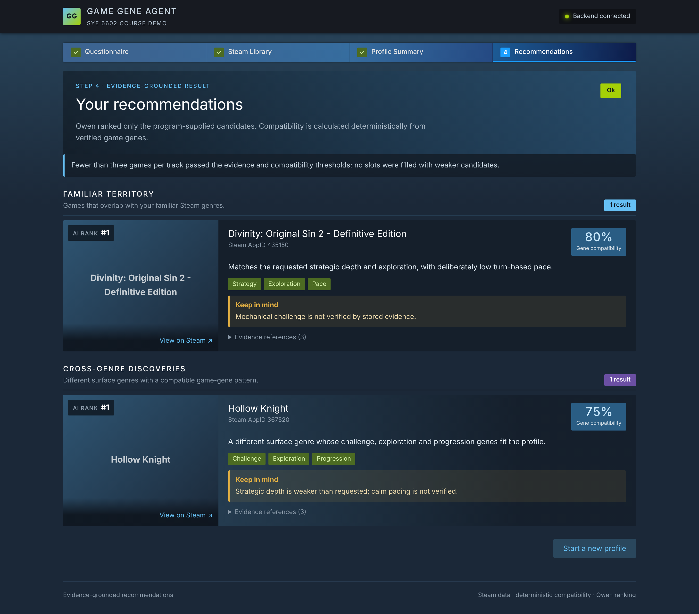

# Game Gene Agent V1.3

An evidence-grounded Steam game recommendation tool built with FastAPI, React,
SQLite, the Steam Web API, and Alibaba Cloud Model Studio (Qwen).

Unlike a generic chatbot recommender, the application keeps retrieval deterministic:
hard filters, owned-game exclusion, same-track/cross-track classification, and
compatibility scores are computed by the program. Qwen parses optional free text and
ranks only the supplied candidate whitelist. Every displayed match must reference
stored evidence.

## Current status

- React questionnaire and four-step recommendation workflow
- FastAPI API with SQLite persistence and background jobs
- Nine fixed game-gene dimensions with 0–4 levels
- Balanced 30-game MVP catalog: six genre buckets × five games
- 29 verified games and one intentionally partial game
- Public Steam library preview, playtime signal, favorites, and owned-game exclusion
- Same-track and cross-track deterministic Top-5 retrieval
- Qwen final Top-3 ranking with evidence-ID validation and one repair attempt
- 59 backend tests and 5 frontend tests passing
- Real Steam + Qwen end-to-end workflow validated

The implementation is complete through Batch 6C. See
[the live E2E report](outputs/Batch_6C_Live_E2E_Report.md) for the latest verification.

## Interface

The React UI follows Steam storefront conventions: flat square-cornered panels on a deep
navy background, a rectangular step bar, small tag chips, green action buttons, a
discount-block style compatibility badge, a nine-axis gene radar on the profile step, and
full-width recommendation rows with a capsule image and store link.



The screenshot re-renders the result of the 22 November live run recorded in
[the live E2E report](outputs/Batch_6C_Live_E2E_Report.md). More views:
[questionnaire](docs/screenshots/questionnaire.png), [profile](docs/screenshots/profile.png).

## Architecture

```text
React / Vite
    │  /api proxy
    ▼
FastAPI services ── SQLite
    │
    ├── deterministic profile fusion, filters, retrieval, and scoring
    ├── Steam Web API (public owned games and store facts)
    └── Qwen OpenAI-compatible API (free-text parsing and final ranking)
```

Repository layout:

```text
backend/   FastAPI application, domain contracts, algorithms, adapters, and tests
frontend/  React + TypeScript + Vite demonstration UI
outputs/   architecture, development plan, and batch verification reports
```

Detailed design documents:

- [V1.3 architecture specification](outputs/Game_Gene_Agent_V1.3_Architecture_Spec.md)
- [V1.3 development plan](outputs/Game_Gene_Agent_V1.3_Multi_Agent_Development_Plan.md)

## Prerequisites

- Git
- Python 3.11 or newer
- [uv](https://docs.astral.sh/uv/)
- Node.js 20 or newer with npm
- A Steam Web API key for live public-library import
- An Alibaba Cloud Model Studio API key, OpenAI-compatible Base URL, and Qwen model name

The 30-game catalog can be imported and tested offline without Steam or Qwen
credentials. Live preference parsing, Steam import, and final ranking require the
corresponding external services.

## Local deployment

### 1. Clone the repository

```bash
git clone https://github.com/18109508757junjun-dot/game-recommend-tools.git
cd game-recommend-tools
```

### 2. Configure environment variables

macOS/Linux:

```bash
cp .env.example .env
```

Windows PowerShell:

```powershell
Copy-Item .env.example .env
```

Edit `.env` with a text editor:

```dotenv
APP_ENV=development
APP_HOST=127.0.0.1
APP_PORT=8000
FRONTEND_ORIGIN=http://localhost:5173
DATABASE_URL=sqlite:///./app.db

STEAM_WEB_API_KEY=your_steam_web_api_key
REVIEW_AUTHOR_HASH_SALT=choose_a_private_random_string
ANNOTATE_UNCATALOGUED_INVENTORY=false

LLM_PROVIDER=aliyun_qwen
DASHSCOPE_API_KEY=your_model_studio_api_key
QWEN_BASE_URL=your_openai_compatible_base_url
QWEN_MODEL=your_qwen_model_name
QWEN_TIMEOUT_SECONDS=180
```

Do not commit `.env`. Keys are backend-only and are never sent to the browser.

`ANNOTATE_UNCATALOGUED_INVENTORY=false` is the recommended demo setting. All owned
AppIDs are still excluded from recommendations, but games outside the reviewed
catalog are not sent to Qwen for slow paid bulk annotation.

### 3. Install and initialize the backend

```bash
cd backend
uv sync
uv run python -m app.cli.init_db
uv run python -m app.cli.import_curated_catalog
```

Expected catalog import result:

```text
Imported 30 curated games: partial=1, verified=29.
```

The curated import is offline, idempotent, and does not consume Steam or Qwen quota.

### 4. Start the backend

Keep this terminal open:

```bash
cd backend
uv run uvicorn app.main:app --host 127.0.0.1 --port 8000
```

Useful endpoints:

- Health: <http://127.0.0.1:8000/api/health>
- OpenAPI documentation: <http://127.0.0.1:8000/docs>

### 5. Install and start the frontend

Open a second terminal from the repository root:

```bash
cd frontend
npm ci
npm run dev
```

Open <http://localhost:5173>. The header should show **Backend connected**.

### 6. Use the application

1. Complete all nine game-gene sliders and select up to three priorities.
2. Choose one to three familiar genres and optional hard filters.
3. Optionally enter an English free-text preference and confirm parsed constraints.
4. Enter a public 17-digit SteamID64, grant one-time consent, and preview the library.
5. Select meaningful favorite games and the aspects you like about them.
6. Confirm the library, inspect the transparent profile contributions, and generate
   recommendations.
7. Review same-track/cross-track results, compatibility, evidence references, and
   cautions.

The Steam account must expose **Game details** publicly. The Steam API key and the
queried SteamID64 do not have to belong to the same account.

## Tests

Backend:

```bash
cd backend
uv run pytest
```

Frontend:

```bash
cd frontend
npm test -- --run
npm run build
```

Offline catalog validation:

```bash
cd backend
uv run python -m app.cli.import_seed_catalog --validate-only
uv run python -m app.cli.import_curated_catalog
```

Explicit live smoke test (uses configured external services):

```bash
cd backend
uv run python -m app.cli.live_e2e_smoke --steam-id YOUR_PUBLIC_STEAMID64
```

## Catalog and evidence policy

- Every non-null gene level requires a traceable official-description or accepted
  review quote.
- Unsupported dimensions remain `null`; the importer does not fabricate values to
  reach nine genes.
- What Remains of Edith Finch intentionally remains `partial` because only four
  dimensions have sufficiently direct official evidence.
- Qwen cannot select games outside the deterministic candidate whitelist or cite
  unknown evidence IDs.
- Invalid ranking output is rejected and receives at most one constrained repair.
- The UI never displays a second model-invented compatibility score.

## Troubleshooting

### `502 Bad Gateway` during Steam preview

The FastAPI server is running, but its request to Steam failed. If the backend shows
`steam request failed after retries`, verify the following:

1. The target Steam profile and **Game details** are public.
2. `STEAM_WEB_API_KEY` is present in the repository-root `.env`.
3. <https://api.steampowered.com> is reachable from the current network.
4. Wait briefly or try another network if Steam API/Community TLS connections fail.

Do not repeatedly regenerate the key: a transport-level `ConnectError` occurs before
Steam can validate the key or SteamID.

### Frontend shows `Backend unavailable`

- Confirm the backend terminal is still running on `127.0.0.1:8000`.
- Open <http://127.0.0.1:8000/api/health> directly.
- Keep the Vite frontend on port `5173`, or update `FRONTEND_ORIGIN` and the Vite
  proxy together.

### Qwen timeout or validation failure

- Confirm `DASHSCOPE_API_KEY`, `QWEN_BASE_URL`, and `QWEN_MODEL` are all set.
- The Base URL must expose an OpenAI-compatible `/chat/completions` endpoint.
- Increase `QWEN_TIMEOUT_SECONDS` up to 600 if the selected model is slow.
- Do not enable uncatalogued bulk annotation for a normal demo run.

## Security and privacy

- `.env`, SQLite databases, caches, logs, virtual environments, build output, and
  dependency directories are ignored by Git.
- The application requests no Steam password or Steam login.
- SteamID64 is masked after preview and is not committed to source control.
- Review author identifiers are hashed before persistence.
- Store descriptions and review text are treated as untrusted data, never prompt
  instructions.

## License

This repository is a course project. No open-source license has been declared yet;
all rights remain with the repository owner.
